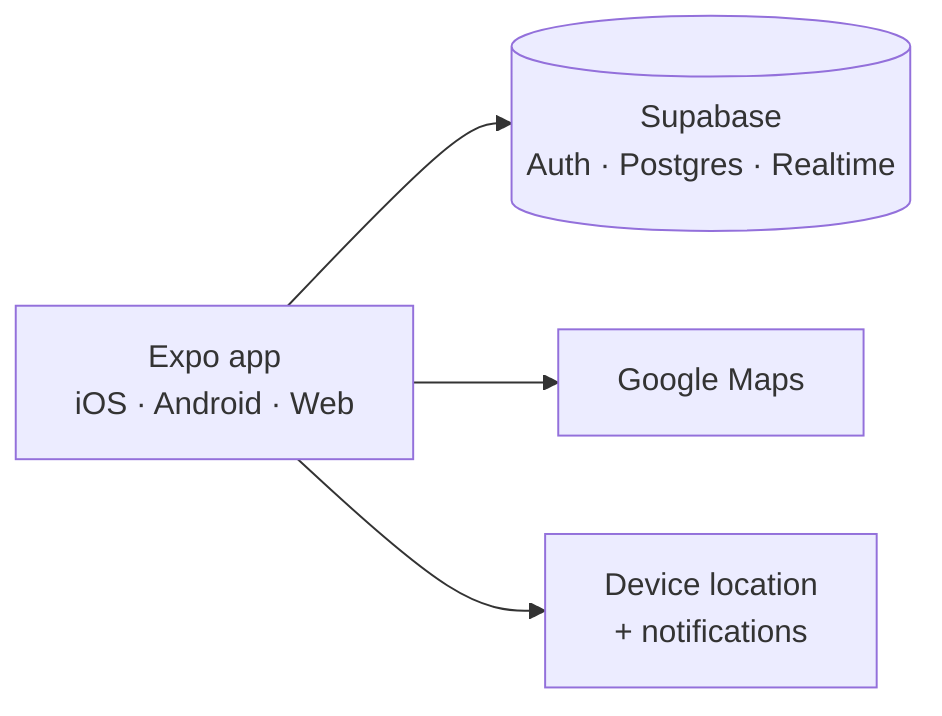

# ParkAlert

**Community parking-warden alerts for UK drivers.** Drivers mark where they have parked and report traffic wardens they see; drivers parked nearby get an alert before a ticket is written. MVP target city: Glasgow.

<!-- Add screenshots here: map, report screen, parked-car alert -->

## MVP scope

| Feature | Detail |
|---|---|
| **Map** | Nearby warden sightings with a visible timestamp; expired sightings drop off the map |
| **Report a warden** | Type, number of wardens, direction and how they are moving |
| **Mark my car** | Save the parked location with a fixed 150 m alert radius |
| **Alert** | Pop-up, sound and haptic alert when a warden is reported inside your radius; 15-minute cooldown, snooze for 30/45/60 minutes |
| **Weak connection** | Parked location is kept locally so the reminder still works offline |
| **Accounts** | Email sign-up required for all features, to keep reports accountable |

The full product spec, roadmap and decisions are in [`产品需求.md`](产品需求.md).

## Status

MVP prototype (March – June 2026). The screens, map, auth, parked-car flow and alert UI are built. The warden-sighting service and database migrations are mid-refactor: the report and live-sighting flows need the service functions and table migrations brought back in line before a clean install works end to end.

## Architecture



## Engineering notes

- **One codebase, three platforms:** Expo / React Native for iOS and Android, Expo web export for Vercel
- **Database security:** a hardening migration enables row-level security, tightens public grants and adds user-owned policies
- **CI:** GitHub Actions runs typecheck, tests and the web build on pushes and pull requests to `master`, with placeholder values only
- **Security:** only the public anon key ships in the client; `service_role` never leaves the server

## Tech stack

Expo · React Native · TypeScript · Supabase · Google Maps · Expo Location / Notifications / Haptics · Jest · GitHub Actions · Vercel

## Run locally

Requirements: Node.js 20+, a Supabase project, a Google Maps API key.

Create a `.env` file:

```bash
EXPO_PUBLIC_SUPABASE_URL=https://your-project.supabase.co
EXPO_PUBLIC_SUPABASE_ANON_KEY=your-public-anon-key
EXPO_PUBLIC_GOOGLE_MAPS_API_KEY=your-google-maps-key
```

```bash
npm install
npm start               # Expo dev server
npm run build:web       # web export
```

## Author

Designed and built by **Dong Wang**.
